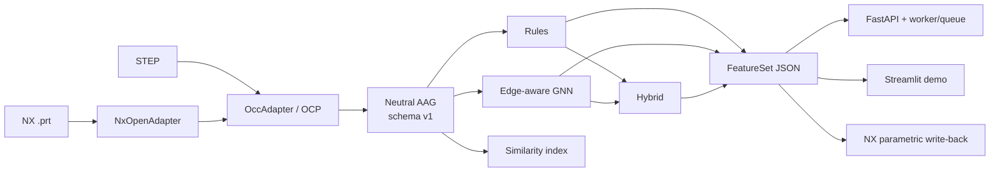

# BRepLens

**CAD-agnostic machining feature recognition, parameter extraction and parametric
rebuild.** Load a STEP file (OpenCascade/OCP) or a Siemens NX part, build an
Attributed Adjacency Graph, recognize features with deterministic rules, a
learned GNN or a measured hybrid, extract manufacturing parameters, find similar
parts, and write features back into NX as parametric features.

> The hosted demo is CPU-only. **NX write-back is UNTESTED against a live NX
> session** and is clearly marked throughout; the NX adapter, mock tests and NX
> guide are complete for desktop validation. See
> [docs/LIMITATIONS.md](docs/LIMITATIONS.md).

## Why

- **One neutral IR** for STEP and NX: faces with analytic type, area, normal,
  axis, radius, bbox, material side; edges with convex/concave/smooth character.
- **Three recognizers on the same schema**: interpretable rules, an edge-aware
  message-passing GNN, and a hybrid that never silently deletes rule output.
- **Measured parameters, not labels only**: diameter, depth, radius, width,
  length, height, angle, position and axis, validated by a versioned Pydantic
  schema with exported JSON Schema.
- **Real evaluation**: held-out synthetic tests, an external MFCAD benchmark,
  retrieval precision@k, deployment memory/latency, and generated tables from
  `results/*.json` (no hand-typed numbers).

## Architecture



Details: [docs/ARCHITECTURE.md](docs/ARCHITECTURE.md).

## 3-command quickstart (hosted demo)

```bash
uv venv --python 3.11
uv pip install -r requirements.txt
streamlit run streamlit_app.py
```

Open the URL Streamlit prints, pick one of the 10 built-in samples (or upload a
STEP file), choose `hybrid` / `rules` / `gnn`, inspect the colored 3D view, the
parameter table, download the JSON and search similar parts.

Full development install, tests and training: [docs/SETUP.md](docs/SETUP.md).

## What the demo does

- Validates uploads (`.step`/`.stp`, ISO-10303-21 magic, size and face limits)
  before the CAD kernel sees them.
- Tessellates with OCP and renders with Plotly `Mesh3d` (no VTK/xvfb).
- Colors faces by recognized feature with a legend; shows base surfaces in gray.
- Displays measured parameters, confidence, face count and position.
- Downloads a schema-versioned feature JSON.
- Searches a 60-part signature library and shows top-k similar parts.
- Caches the model and sample graphs with `st.cache_resource`/`st.cache_data`.
- Runs entirely on CPU; measured peak memory and latencies are generated into
  `results/deploy_benchmark.json` (see the table below).

Deployment steps: [docs/DEPLOY_STREAMLIT.md](docs/DEPLOY_STREAMLIT.md).

## Recognized features

Through hole, blind hole, counterbore, countersink, pocket, slot, step, boss,
fillet, chamfer — with measured parameters. Edge convexity uses a documented
material-side convention (calibrated on box, hole, pocket, blind-hole and fillet
primitives); see the architecture document.

## Project structure

```
src/breplens/
  schema.py            versioned IR + FeatureSet (Pydantic)
  adapters/            CadAdapter, OccAdapter, NxOpenAdapter, NX journal
  geometry/            AAG, tessellation, synthetic ground-truth generator
  recognition/         rules, parameter measurement, GNN instances, hybrid
  ml/                  edge-aware GNN, training, evaluation, MFCAD labels
  similarity/          signatures + cosine index
  service/             FastAPI, SQLAlchemy storage, queue/worker, pipeline
  cli.py               `breplens recognize|schema`
tests/                 unit, integration, NX mock, adversarial/validation
scripts/               generation, conversion, training, evaluation, benchmarks
docs/                  research, architecture, setup, datasets, licenses,
                       limitations, NX guide, deployment, CV, final report
samples/               10 generated STEP parts (committed, MIT)
models/                small CPU checkpoints (committed)
demo/library.json      60-part similarity index
docker/                service requirements
results/               machine-generated result files (source of truth)
```

## Reproduce the results

```bash
python scripts/generate_synthetic.py --per-family 150 --workers 16
python scripts/convert_mfcad.py --limit 3000 --workers 16      # needs raw MFCAD
python scripts/train_gnn.py --dataset synthetic --epochs 35
python scripts/train_gnn.py --dataset mfcad --epochs 30
python scripts/evaluate_rules.py --split test
python scripts/evaluate_synthetic_three_ways.py
python scripts/evaluate_head_to_head.py
python scripts/evaluate_similarity.py
python scripts/benchmark_perf.py --out results/perf.json
python scripts/make_readme_tables.py
```

Tests/lint/types:

```bash
pytest -q
ruff check src tests scripts streamlit_app.py
mypy src/breplens
```

CI (`.github/workflows/ci.yml`) runs the CPU path: ruff, mypy, pytest with a 70%
project floor and an 80% core geometry/recognition/schema floor.

## NX Open (desktop, UNTESTED live)

The adapter exports the open NX part to STEP for graph construction and writes
recognized features back as parametric NX features. Holes and bosses follow
candidate public NX Open recipes; pockets/slots use parametric subtractive blocks
because native builder APIs could not be verified. Counterbores/countersinks,
fillets/chamfers, and non-Z-axis placements are skipped with explicit warnings.
Mock tests validate the translation logic only.

Read [docs/NX_GUIDE.md](docs/NX_GUIDE.md) before running it, and complete the
verification checklist.

## Docker service

```bash
docker compose up --build          # API :8000 + SQLite worker
docker compose -f docker-compose.rq.yml up --build   # Redis/RQ variant
```

The API exposes `POST /v1/jobs`, `GET /v1/jobs/{id}`,
`GET /v1/jobs/{id}/features`, `GET /v1/jobs/{id}/similar`, `/v1/schema`,
`/health`. Storage defaults to SQLite and supports PostgreSQL via
`BREPLENS_DATABASE_URL`.

## Documentation

- [Research and source verification](docs/RESEARCH.md)
- [Architecture and interfaces](docs/ARCHITECTURE.md)
- [Setup and environment audit](docs/SETUP.md)
- [Datasets and data cards](docs/DATASETS.md)
- [Limitations and failure cases](docs/LIMITATIONS.md)
- [NX guide](docs/NX_GUIDE.md)
- [Streamlit deployment](docs/DEPLOY_STREAMLIT.md)
- [Licenses](docs/LICENSES.md)
- [CV summary](docs/CV_SUMMARY.md)
- [Final report](docs/FINAL_REPORT.md)

<!-- RESULTS:START -->
## Results

All tables are generated by `python scripts/make_readme_tables.py` from
`results/*.json`; none of these numbers are hand-written.

### Datasets

| Dataset | Parts | Split (train/val/test) | Labels | License |
| --- | ---: | --- | --- | --- |
| Synthetic (`data/synthetic`) | 1650 | 1156/248/246 | per-face class + feature params | MIT (generated) |
| MFCAD subset (`data/mfcad`) | 3000 | 2100/452/448 | 16 face classes (15 features + stock) | MIT |
| MFCAD++ | 59,665 available | official 41,766/8,950/8,949 | 25 classes | CC BY |


### Recognition head-to-head (synthetic test)

| Method | Feature P | Feature R | Feature F1 | Exact part rate | Face acc. | Face macro F1 | ms/part |
| --- | ---: | ---: | ---: | ---: | ---: | ---: | ---: |
| rules | 1.000 | 1.000 | 1.000 | 1.000 | 1.000 | 1.000 | 0.18 |
| gnn | 1.000 | 1.000 | 1.000 | 1.000 | 1.000 | 1.000 | 1.63 |
| hybrid | 1.000 | 1.000 | 1.000 | 1.000 | 1.000 | 1.000 | 2.60 |

*246 held-out synthetic parts; same split for all methods; latency is recognition only, CPU.*

### GNN ablation

| Dataset | Architecture | Parameters | Test face acc. | Test macro F1 | Train s | CPU ms/graph |
| --- | --- | ---: | ---: | ---: | ---: | ---: |
| synthetic | gcn | 18635 | 1.0000 | 1.0000 | 2.35 | 0.54 |
| synthetic | edge_gnn | 120011 | 1.0000 | 1.0000 | 1.20 | — |
| MFCAD | gcn | 18960 | 0.9381 | 0.8909 | 4.90 | — |
| MFCAD | edge_gnn | 120336 | 0.9986 | 0.9982 | 4.50 | 0.43 |

*GCN = baseline without edge attributes; `edge_gnn` = edge-aware message passing. Early stopping on the validation split only.*

### External benchmark on MFCAD (macro classes)

| Method (8 macro classes) | Accuracy | Macro F1 | Faces |
| --- | ---: | ---: | ---: |
| rules | 0.4034 | 0.2180 | 10146 |
| gnn | 0.9989 | 0.9983 | 10146 |
| hybrid_rule_priority | 0.7422 | 0.6366 | 10146 |
| hybrid_gnn_priority | 0.9989 | 0.9983 | 10146 |
| hybrid_vote | 0.9989 | 0.9983 | 10146 |

*MFCAD test split: 448 parts. Full 16-class GNN: accuracy 0.9986, macro F1 0.9982. Rules were designed and tuned on the synthetic families and were not retuned on MFCAD.*

### Similarity retrieval

| Dataset | Library | Queries | P@1 | P@5 | P@10 | P@1 (Jaccard≥0.5) | Query ms |
| --- | ---: | ---: | ---: | ---: | ---: | ---: | ---: |
| Synthetic | 1404 | 246 | 1.000 | 1.000 | 1.000 | 1.000 | 0.33 |
| MFCAD | 2552 | 448 | 0.150 | 0.133 | 0.118 | 0.746 | 0.85 |

*Relevance = same family label; MFCAD families are coarse macro compositions. The Jaccard column treats compositions sharing at least half their feature set as relevant.*

### Performance (before/after, real runs)

| Stage | Mean ms (after) | Median ms | Mean ms (before) | Speedup |
| --- | ---: | ---: | ---: | ---: |
| graph from step | 11.05 | 6.50 | 12.11 | 1.09 |
| rules | 0.14 | 0.08 | — | — |
| gnn | 1.69 | 1.56 | — | — |
| hybrid | 3.39 | 3.18 | — | — |
| signature | 0.27 | 0.28 | — | — |
| tessellate | 3.89 | 3.78 | — | — |
| end to end step hybrid json | 8.54 | 7.86 | — | — |

*Before/after is reported only for the graph-build optimization measured by the same script; other stages are current observations, not claimed optimizations.*

### Hosted Streamlit demo (CPU, inference-only environment)

| Metric | Value |
| --- | ---: |
| Environment size | 2413.2 MB |
| Fresh pip install | 147 s |
| AppTest cold start | 0.60 s |
| First part incl. model load | 1.53 s |
| Peak RSS (app probe) | 854.4 MB |
| Peak RSS (pipeline probe) | 856.3 MB |
| Headless server start | 0.41 s |
| Rules latency | 0.16 ms |
| GNN latency | 1.07 ms |
| Hybrid latency | 1.72 ms |
| Tessellation latency | 7.26 ms |

*Measured on the inference-only venv, CPU, 10 committed sample parts; raw data in `results/deploy_benchmark.json`.*

### Quality gates

| Check | Result |
| --- | ---: |
| Tests passed | 80 |
| Tests failed | 0 |
| Test wall time | 6.21 s |
| Full line coverage | 74.01% |
| Core geometry/recognition/schema coverage | 82.20% |


### Docker service smoke test

| Queue | API health | End-to-end s | Job | Features | Load ms | Recognition ms |
| --- | --- | ---: | --- | ---: | ---: | ---: |
| SQLite worker | ok | 1.90 | succeeded | 8 | 31.8 | 4.35 |
| RQ + Redis worker | ok | 2.04 | succeeded | 8 | 20.7 | 5.30 |

### Data and training wall-clock

| Pipeline step | Wall time | Source |
| --- | ---: | --- |
| Synthetic generation (1,650 parts, 16 workers) | 5.48 s | `data/synthetic/manifest.json` |
| MFCAD conversion (3,000 parts, 16 workers) | 10.39 s | `data/mfcad/manifest.json` |
| Synthetic GNN training (gcn) | 2.35 s | `results/gnn_eval.json` |
| MFCAD GNN training (edge_gnn) | 4.50 s | `results/mfcad_gnn_eval.json` |

<!-- RESULTS:END -->

## License

MIT (see [LICENSE](LICENSE)). Sample STEP files are generated by this project and
redistributable under MIT. MFCAD is MIT; MFCAD++ is CC BY but was not downloaded
(see [docs/DATASETS.md](docs/DATASETS.md)). No secrets are stored in the repo.
