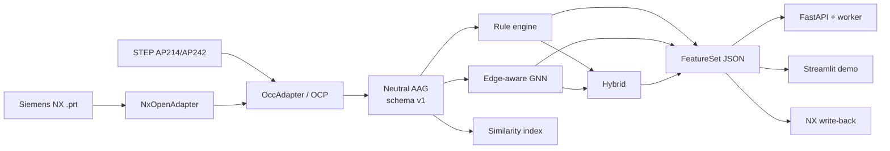

<p align="center">
  
</p>

<h1 align="center">BRepLens</h1>

<p align="center"><strong>See the part. Know the features.</strong></p>

<p align="center">
  CAD-agnostic machining feature recognition for STEP parts.<br>
  Reads a B-Rep, builds an attributed graph, and returns measured features you can inspect, export, and rebuild.
</p>

<p align="center">
  v1.2.0 &nbsp;|&nbsp; Python 3.11+ &nbsp;|&nbsp; MIT &nbsp;|&nbsp; schema 1.0.0
</p>

---

BRepLens is a working tool, not a mockup. It loads real STEP geometry with
OpenCascade, classifies faces and edges, recognizes ten machining feature types,
and measures their parameters. The same neutral graph feeds a rule engine, a
learned GNN, and a conservative hybrid. A Streamlit demo and a FastAPI service
ship with the repository.

The project is CAD-agnostic by design. STEP is implemented and tested. Siemens
NX has an adapter and write-back path, but it is explicitly marked **untested
against a live NX session** because no NX installation was available here.

## What it does

1. **Reads CAD.** STEP AP214 and AP242 through OCP. NX parts through NX Open,
   with a STEP export fallback for graph construction.
2. **Builds a neutral B-Rep graph.** Faces carry surface type, area, normal, axis,
   radius, bounding box, and material side. Edges carry convex, concave, or
   smooth character.
3. **Recognizes features.** Through hole, blind hole, counterbore, countersink,
   pocket, slot, step, boss, fillet, and chamfer.
4. **Measures parameters.** Diameter, depth, radius, length, width, height,
   angle, position, and axis, validated by a versioned Pydantic schema.
5. **Compares engines.** Deterministic rules, an edge-aware GNN, and a hybrid
   that keeps rule output and adds only non-overlapping GNN findings.
6. **Finds similar parts.** A graph and geometry signature index with measured
   precision at k.
7. **Writes back to NX.** Parametric holes, bosses, and conservative subtractive
   block cuts for pockets and slots. Mock-tested, not live-tested.
8. **Ships a demo and a service.** Streamlit for inspection, FastAPI and a
   worker queue for programmatic use.

## Try the demo

```bash
uv venv --python 3.11
uv pip install -r requirements.txt
.venv/bin/streamlit run streamlit_app.py
```

Open the local URL, pick one of the ten sample parts, and use the tabs to inspect
the 3D view, measured features, engine comparison, similar parts, and JSON.

A full development setup, including CUDA training and tests, is in
[docs/SETUP.md](docs/SETUP.md).

## Current status

This is the honest part.

| Area | State |
| --- | --- |
| STEP import and neutral graph | Working, tested |
| Rule-based recognition | Working, evaluated |
| GNN face classification | Working, evaluated |
| Hybrid recognition | Working, evaluated |
| Parameter extraction and schema | Working, validated |
| Similarity search | Working, evaluated |
| FastAPI, worker queue, Docker | Working, integration tested |
| Streamlit demo | Working, fresh-venv tested |
| NX Open adapter | Complete and mocked, **not live-tested** |
| MFCAD++ benchmark | Not available: official download blocked |
| Multi-view CNN part family | Working, but weaker than the graph model |
| Production hardening | Not done: no auth, quotas, or PostgreSQL load test |

The synthetic test set is clean and designed by the same generator used for
training. High scores there are useful for regression and plumbing, not proof of
real shop-floor accuracy. The MFCAD benchmark is a better external check. The
rule engine is weak on MFCAD classes because it was not trained for them. That is
reported, not hidden.

## Results

All tables below are generated from `results/*.json` by
`python scripts/make_readme_tables.py`. No result number is typed by hand.

<!-- RESULTS:START -->
## Results

All tables are generated by `python scripts/make_readme_tables.py` from
`results/*.json`; none of these numbers are hand-written.

### Datasets

| Dataset | Parts | Split (train/val/test) | Labels | License |
| --- | ---: | --- | --- | --- |
| Synthetic (`data/synthetic`) | 1650 | 1156/248/246 | per-face class + feature params | MIT (generated) |
| MFCAD subset (`data/mfcad`) | 3000 | 2100/452/448 | 16 face classes (15 features + stock) | MIT |


### Recognition head-to-head (synthetic test)

| Method | Feature P | Feature R | Feature F1 | Exact part rate | Face acc. | Face macro F1 | ms/part |
| --- | ---: | ---: | ---: | ---: | ---: | ---: | ---: |
| rules | 1.000 | 1.000 | 1.000 | 1.000 | 1.000 | 1.000 | 0.18 |
| gnn | 1.000 | 1.000 | 1.000 | 1.000 | 1.000 | 1.000 | 1.63 |
| hybrid | 1.000 | 1.000 | 1.000 | 1.000 | 1.000 | 1.000 | 2.65 |

*246 held-out synthetic parts; same split for all methods; latency is recognition only, CPU.*

### GNN ablation

| Dataset | Architecture | Parameters | Test face acc. | Test macro F1 | Train s | CPU ms/graph |
| --- | --- | ---: | ---: | ---: | ---: | ---: |
| synthetic | gcn | 18635 | 1.0000 | 1.0000 | 2.35 | 0.54 |
| synthetic | edge_gnn | 120011 | 1.0000 | 1.0000 | 1.20 | - |
| MFCAD | gcn | 18960 | 0.9381 | 0.8909 | 4.90 | - |
| MFCAD | edge_gnn | 120336 | 0.9986 | 0.9982 | 4.50 | 0.43 |

*GCN = baseline without edge attributes; `edge_gnn` = edge-aware message passing. Early stopping on the validation split only.*

### Optional multi-view CNN (part family)

| Method | Test accuracy | Macro F1 | Parameters | Train s | CPU ms/part | Model MB |
| --- | ---: | ---: | ---: | ---: | ---: | ---: |
| cnn_multiview | 0.8171 | 0.8119 | 29115 | 6.15 | 0.53 | 0.120 |
| graph_gnn | 1.0000 | 1.0000 | 124107 | 1.61 | 0.56 | 0.484 |

*Optional Phase 9: six orthographic shaded views (96x96, ±X/±Y/±Z) for the CNN; the graph classifier uses the AAG. Same synthetic parts, split and seed.*

### External benchmark on MFCAD (macro classes)

| Method (8 macro classes) | Accuracy | Macro F1 | Faces |
| --- | ---: | ---: | ---: |
| rules | 0.4034 | 0.2180 | 10146 |
| gnn | 0.9989 | 0.9983 | 10146 |
| hybrid_rule_priority | 0.7422 | 0.6366 | 10146 |
| hybrid_gnn_priority | 0.9989 | 0.9983 | 10146 |
| hybrid_vote | 0.9989 | 0.9983 | 10146 |

*MFCAD test split: 448 parts. Full 16-class GNN: accuracy 0.9986, macro F1 0.9982. Rules were designed and tuned on the synthetic families and were not retuned on MFCAD.*

### Similarity retrieval

| Dataset | Library | Queries | P@1 | P@5 | P@10 | P@1 (Jaccard≥0.5) | Query ms |
| --- | ---: | ---: | ---: | ---: | ---: | ---: | ---: |
| Synthetic | 1404 | 246 | 1.000 | 1.000 | 1.000 | 1.000 | 0.34 |
| MFCAD | 2552 | 448 | 0.150 | 0.133 | 0.118 | 0.746 | 0.86 |

*Relevance = same family label; MFCAD families are coarse macro compositions. The Jaccard column treats compositions sharing at least half their feature set as relevant.*

### Performance (before/after, real runs)

| Stage | Mean ms (after) | Median ms | Mean ms (before) | Speedup |
| --- | ---: | ---: | ---: | ---: |
| graph from step | 11.05 | 6.50 | 12.11 | 1.09 |
| rules | 0.14 | 0.08 | - | - |
| gnn | 1.69 | 1.56 | - | - |
| hybrid | 3.39 | 3.18 | - | - |
| signature | 0.27 | 0.28 | - | - |
| tessellate | 3.89 | 3.78 | - | - |
| end to end step hybrid json | 8.54 | 7.86 | - | - |

*Before/after is reported only for the graph-build optimization measured by the same script; other stages are current observations, not claimed optimizations.*

### Hosted Streamlit demo (CPU, inference-only environment)

| Metric | Value |
| --- | ---: |
| Environment size | 2413.2 MB |
| Fresh pip install | 147 s |
| AppTest cold start | 1.79 s |
| First part incl. model load | 0.15 s |
| Peak RSS (app probe) | 873.4 MB |
| Peak RSS (pipeline probe) | 874.0 MB |
| Headless server start | 0.41 s |
| Rules latency | 0.18 ms |
| GNN latency | 1.40 ms |
| Hybrid latency | 1.84 ms |
| Tessellation latency | 8.59 ms |

*Measured on the inference-only venv, CPU, 10 committed sample parts; raw data in `results/deploy_benchmark.json`.*

### Quality gates

| Check | Result |
| --- | ---: |
| Tests passed | 92 |
| Tests failed | 0 |
| Test wall time | 7.39 s |
| Full line coverage | 71.79% |
| Core geometry/recognition/schema coverage | 83.04% |


### Docker service smoke test

| Queue | API health | End-to-end s | Job | Features | Load ms | Recognition ms |
| --- | --- | ---: | --- | ---: | ---: | ---: |
| SQLite worker | ok | 2.10 | succeeded | 8 | 21.4 | 4.53 |
| RQ + Redis worker | ok | 2.06 | succeeded | 8 | 20.5 | 4.13 |

### Data and training wall-clock

| Pipeline step | Wall time | Source |
| --- | ---: | --- |
| Synthetic generation (1650 parts, 16 workers) | 5.56 s | `data/synthetic/manifest.json` |
| MFCAD conversion (3000 parts, 16 workers) | 10.22 s | `data/mfcad/manifest.json` |
| Synthetic GNN training (gcn) | 2.35 s | `results/gnn_eval.json` |
| MFCAD GNN training (edge_gnn) | 4.50 s | `results/mfcad_gnn_eval.json` |

<!-- RESULTS:END -->

## How it works



The full design, including the edge convexity convention and schema contract, is
in [docs/ARCHITECTURE.md](docs/ARCHITECTURE.md).

## Project layout

```
src/breplens/
  schema.py              versioned IR and FeatureSet models
  adapters/              CadAdapter, OccAdapter, NxOpenAdapter, NX journal
  geometry/              AAG, tessellation, synthetic ground-truth generator
  recognition/           rules, measurement helpers, GNN grouping, hybrid
  ml/                    GNN, family CNN, multi-view renderer, training, evaluation
  similarity/            signatures and cosine index
  service/               FastAPI, SQLAlchemy storage, queue worker, pipeline
  cli.py                 breplens recognize and breplens schema
tests/                   unit, integration, NX mock, adversarial cases
scripts/                 data generation, training, evaluation, benchmarks, reports
docs/                    research, architecture, setup, datasets, limits, NX, deploy
assets/                  logo and wordmark
samples/                 ten generated STEP parts
models/                  small committed CPU checkpoints
demo/                    similarity library
results/                 machine-generated results, the source of truth for tables
streamlit_app.py         hosted demo
docker/                  service requirements
```

## Service API

```bash
docker compose up --build
```

The API listens on port 8000 and exposes:

| Method | Path | Purpose |
| --- | --- | --- |
| `GET` | `/health` | Service and model status |
| `POST` | `/v1/jobs` | Upload a STEP file and queue recognition |
| `GET` | `/v1/jobs` | Recent jobs |
| `GET` | `/v1/jobs/{id}` | Job status and timings |
| `GET` | `/v1/jobs/{id}/features` | Validated FeatureSet JSON |
| `GET` | `/v1/jobs/{id}/similar` | Similar parts |
| `GET` | `/v1/schema` | Feature JSON Schema |

SQLite is the default store and queue. PostgreSQL can be selected with
`BREPLENS_DATABASE_URL`. RQ and Redis are available as an optional queue backend;
both Docker Compose stacks were smoke-tested.

## NX Open

The NX path exports the open part to STEP for graph construction and creates
parametric features from a FeatureSet. Holes and bosses follow candidate recipes
from a public NX Open cookbook. Pockets and slots use parametric subtractive block
features because native builder APIs could not be verified. Counterbores,
countersinks, fillets, chamfers, and non-Z axes are skipped with explicit
warnings.

**No live NX session was available.** The adapter, mock, journal entry points, and
checklist are complete, but this path needs a pilot validation before production
use. Read [docs/NX_GUIDE.md](docs/NX_GUIDE.md) first.

## Datasets and training

- **Synthetic primary set:** 1,650 generated parts across 11 families, with
  construction-derived face labels and feature parameters. Used for the demo
  model and all feature-level evaluation.
- **MFCAD external set:** a 3,000-part subset of the MIT-licensed MFCAD dataset,
  used for the external face-classification benchmark.
- **MFCAD++:** reported on its official page, but the zip download was blocked by
  a Cloudflare challenge in this environment. It is listed as future work.

Data cards, licenses, and exact reproduction commands are in
[docs/DATASETS.md](docs/DATASETS.md).

Training is deterministic and CPU-friendly for inference. The training machine
used an RTX 3060 Ti with mixed precision where useful. CPU-only paths are
tested.

## Verification

Run the local gates:

```bash
pytest -q
ruff check src tests scripts streamlit_app.py
mypy src/breplens
python scripts/run_quality_gates.py
```

There is no CI pipeline in this repository. The local gate runs the same checks:
lint, types, tests, coverage, and a service import smoke test. Results are written
to `results/tests.json` and `results/coverage*.json`.

The Streamlit demo was verified in a fresh pip-only CPU environment, including a
headless server start and all ten sample parts. Deployment details are in
[docs/DEPLOY_STREAMLIT.md](docs/DEPLOY_STREAMLIT.md).

## Limitations

The short list:

- Feature vocabulary is fixed. Freeform cavities, passages, assemblies, and mixed
  units are out of scope.
- Rule scores on synthetic data are a regression signal, not real-world accuracy.
- MFCAD is an easy face-classification benchmark and does not cover holes or
  fillets.
- The hybrid is conservative and cannot repair a wrong rule feature.
- Similarity is weak on exact MFCAD macro compositions.
- The CNN part-family model is weaker than the graph model and is synthetic-only.
- NX write-back is untested on a live session.
- The service is not hardened for multi-tenant production.

The detailed failure modes are in [docs/LIMITATIONS.md](docs/LIMITATIONS.md).

## Reproduction

```bash
python scripts/generate_synthetic.py --per-family 150 --workers 16
python scripts/convert_mfcad.py --limit 3000 --workers 16
python scripts/train_gnn.py --dataset synthetic --epochs 35
python scripts/train_gnn.py --dataset mfcad --epochs 30
python scripts/evaluate_rules.py --split test
python scripts/evaluate_synthetic_three_ways.py
python scripts/evaluate_head_to_head.py
python scripts/evaluate_similarity.py
python scripts/render_dataset.py
python scripts/train_family_models.py
python scripts/benchmark_perf.py --out results/perf.json
python scripts/make_readme_tables.py
```

The README result tables are rebuilt from the JSON files after those scripts run.

## Deploy the demo

The app is ready for Streamlit Community Cloud. Use `streamlit_app.py` as the
entry point, Python 3.12 or 3.11, and `requirements.txt` as the dependency file.
No secrets are needed. The deployment guide covers limits, packages, and the
memory budget: [docs/DEPLOY_STREAMLIT.md](docs/DEPLOY_STREAMLIT.md).

## Topics

If you publish this repository on GitHub, use these topics:

`cad` `step` `brep` `feature-recognition` `machining` `manufacturing`
`cnc` `opencascade` `ocp` `pytorch` `graph-neural-network` `streamlit`
`fastapi` `nx-open` `mechanical-engineering` `cadquery`

## Documentation

| Document | What it covers |
| --- | --- |
| [Research](docs/RESEARCH.md) | Sources, datasets, kernels, and prior work |
| [Architecture](docs/ARCHITECTURE.md) | Interfaces, IR, schema, and edge conventions |
| [Setup](docs/SETUP.md) | Environment audit and exact install commands |
| [Datasets](docs/DATASETS.md) | Data cards, licenses, and download verification |
| [Limitations](docs/LIMITATIONS.md) | Failure cases and honest scope |
| [NX guide](docs/NX_GUIDE.md) | Live validation checklist and write-back limits |
| [Deployment](docs/DEPLOY_STREAMLIT.md) | Streamlit Community Cloud steps |
| [CV summary](docs/CV_SUMMARY.md) | Five measured, truthful bullets |
| [Final report](docs/FINAL_REPORT.md) | Full build and evaluation report |

## License

MIT. See [LICENSE](LICENSE).

The sample STEP files were generated by this project and are redistributable
under MIT. MFCAD is MIT and is downloaded by script, not committed. MFCAD++ is
CC BY but was not downloaded. See [docs/LICENSES.md](docs/LICENSES.md).

---

<p align="center">
  <strong>BRepLens</strong> &nbsp;|&nbsp; See the part. Know the features.
</p>
