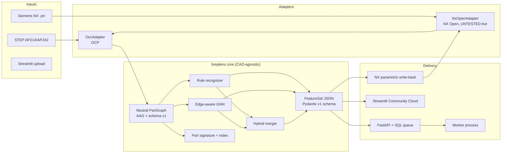

# BRepLens Architecture

Version 1.0.0 · schema version 1.0.0

## 1. System context



## 2. Module boundaries

| Package | Responsibility | May import |
| --- | --- | --- |
| `breplens.schema` | neutral IR, FeatureSet, JSON Schema | pydantic only |
| `breplens.geometry` | AAG conversion, synthetic generator | schema, numpy, networkx; CadQuery only lazily inside generator |
| `breplens.adapters.base` | `CadAdapter` contract and typed errors | schema |
| `breplens.adapters.occ` | STEP → PartGraph, tessellation | OCP, schema |
| `breplens.adapters.nx` | NX traversal, STEP export, write-back | NXOpen (lazy), OCP adapter |
| `breplens.recognition` | rules, parameters, GNN feature grouping, hybrid | schema, geometry, numpy |
| `breplens.ml` | GNN model, training, evaluation, inference | torch, PyG, schema |
| `breplens.similarity` | signatures and cosine index | schema, numpy |
| `breplens.service` | API, worker, storage, pipeline | FastAPI, SQLAlchemy, core |
| `streamlit_app.py` | hosted demo | core, OCP, streamlit, plotly |

Dependency rule: **nothing outside `adapters/` may import OCP, CadQuery or
NXOpen; nothing outside `ml/` may import torch.** `tests/test_architecture.py`
enforces both by scanning source imports. The Streamlit app imports OCP through
`OccAdapter` only; it never imports CadQuery or VTK.

## 3. Neutral IR

`PartGraph` (schema v1.0.0) contains:

- `faces: FaceRecord[]` — stable contiguous `id`, analytic `surface_type`
  (plane/cylinder/cone/sphere/torus/bspline/other), area, centroid, axis-aligned
  bounding box, outward normal for planes, axis origin/direction + radius for
  revolution surfaces, cone semi-angle, torus major/minor radius,
  `material_side` for cylinders (`inside` = boss/fillet, `outside` = hole),
  optional dataset label.
- `edges: EdgeRecord[]` — `face_a`, `face_b`, convexity
  (convex/concave/smooth/unknown), length, curve type, midpoint, mean dihedral.
- `metadata` — name, units (always mm after import), bbox, volume, counts,
  generator/family for datasets.

All lengths are millimetres and angles degrees. STEP import forces the
OpenCascade unit to MM (`xstep.cascade.unit`). Assemblies are flattened to the
first-level solids; no placement transforms are applied beyond STEP import.

### Convexity convention

Outward face normals are corrected by face orientation. For a manifold edge:

```
t = edge tangent, oriented along face A's wire
s = (n_A × n_B) · t        (mean sign over 25/50/75% samples)
s > 0  → convex
s < 0  → concave
mean normal angle < 12° → smooth (tangent blend)
```

Calibration tests: box → all convex; pocket floor/walls → concave; blind-hole
floor/wall → concave; through-hole rims → convex (material-side convention);
vertical fillets → smooth. This convention is deliberately **material-side**;
some papers use the void-side polarity, which flips hole rims. The convention is
part of the schema contract and is covered by tests.

## 4. Feature schema (v1)

```
FeatureSet
├── schema_version: "1.0.0"
├── part, mode, created_utc
├── features: Feature[]
│   ├── id, type, confidence, face_ids, source ("rules"|"gnn"|"hybrid")
│   ├── params: FeatureParams (only measured fields populated)
│   └── position, axis, notes
├── summary: PartSummary
├── timings: TimingBreakdown
├── warnings[]
├── model_version
└── extra{}
```

Feature types: through_hole, blind_hole, counterbore, countersink, pocket,
slot, step, boss, fillet, chamfer, unknown. `params` carries diameter,
inner/outer diameter, depth, radius, length, width, height, angle, chamfer
width, wall count, `is_through`, and a numeric `extra` map.

The exported JSON Schema lives at `docs/schema.v1.json`, generated by
`scripts/export_schema.py`. Backwards-incompatible changes bump both
`SCHEMA_VERSION` and this document.

## 5. CadAdapter contract

```python
class CadAdapter(ABC):
    name: str
    supported_suffixes: tuple[str, ...]
    def load_graph(path, *, name=None) -> PartGraph
    def tessellate(path, *, deflection=0.2) -> MeshData
    def write_features(path, features) -> str   # NX only; typed failure otherwise
```

- `OccAdapter` is the production path and fully tested.
- `NxOpenAdapter` exports the open NX part to STEP with the documented
  `DexManager` recipe and delegates graph/tessellation to `OccAdapter`, avoiding
  unverified per-face geometry calls. Write-back uses a candidate cookbook recipe
  for holes/bosses and a parametric subtractive block for pockets/slots; all NX
  paths are UNTESTED against a live session. **Every NX path is marked `UNTESTED against a live NX
  session`.**

## 6. Recognition pipeline

1. Adapter validates file and builds `PartGraph` (O(F+E)).
2. Mode dispatch:
   - `rules`: deterministic geometric recognizers.
   - `gnn`: face-class probabilities → connected components → measured
     parameters (same geometry helpers as rules).
   - `hybrid`: rules first; add non-overlapping, high-confidence GNN components;
     confidence fused; conflicts reported as warnings.
3. Output is Pydantic-validated and written atomically as JSON.
4. Similarity: block-weighted signature (geometry, surfaces, convexity, feature
   histogram, radii/areas/edge/dihedral histograms, WL colour histogram) →
   L2-normalized cosine index.

### Rule order

Counterbores/countersinks → holes → bosses → pockets/slots/steps → fillets →
chamfers. Earlier features claim faces; later detectors cannot reuse them. This
ordering encodes feature composition (a counterbore contains a hole) and is
covered by intersecting-feature tests.

### GNN

Node features (19): one-hot surface, log area, normal, axis, log radius,
log bbox diagonal, centroid offset. Edge features (7): one-hot
convexity, log length, sin/cos dihedral. An `EdgeAwareLayer` uses messages that are an MLP of
`[h_src, h_dst, edge_attr]`, a `GRUCell` update, residual and LayerNorm. A plain
`GCNConv` network is the ablation/baseline. Both saturate the synthetic test set;
the smaller GCN is retained for the demo while the edge-aware model is selected
on MFCAD. Checkpoints are self-describing (config, class names, feature names,
metadata); checkpoint sizes are recorded in `results/gnn_eval.json` and
`results/mfcad_gnn_eval.json`.

## 7. Errors

| Error | Raised when | HTTP |
| --- | --- | --- |
| `CadLoadError` | unreadable/empty/non-STEP/no faces | 422 |
| `UnsupportedFormatError` | unknown suffix | 415 |
| `ValidationError` | limits, schema violation | 422/413 |
| `RecognitionError` | recognizer failure | 500 job failure |
| `WriteBackError` | NX operation unsupported/failed | journal report |
| `BRepLensError` | base class | — |

Uploads are streamed with a hard MiB limit, extension + ISO-10303-21 magic
checked, and stored under UUID names (no path traversal). API errors are
structured; job failures are stored on the job, never silently swallowed.

## 8. Service and deployment

- FastAPI exposes upload/submit/status/features/similarity/schema/health.
- Jobs are rows in SQLite via SQLAlchemy; SQLite default, PostgreSQL by
  `DATABASE_URL`.
- Queue: SQLite table polled by a separate worker process (default, no external
  service). Optional RQ+Redis mode dispatches the same job function; job state
  stays in SQL.
- Atomic row claim (`status=queued` → `running` with rowcount check); stale
  running jobs can be requeued.
- Streamlit demo is a separate CPU-only process using committed sample STEPs,
  GNN weights and a 60-part signature library. No FastAPI/Redis/NX required.

## 9. Determinism

All randomness derives from explicit seeds (dataset `20261124`, training `42`);
PyTorch deterministic algorithms are requested; dataset splits use MD5 of the
part name; graph face/edge order follows OpenCascade traversal; feature ordering
is deterministic by type and minimum face id.
